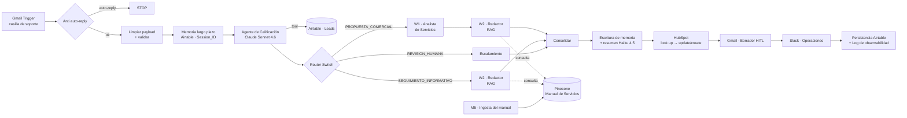

[README.md](https://github.com/user-attachments/files/33436048/README.md)
# AutoFlow IA · Orquestador de Leads con IA (n8n)

Sistema multiagente en **n8n** que recibe consultas comerciales por correo, califica al lead con un agente de IA, delega el análisis y la redacción en Workers especializados, fundamenta las respuestas en una base de conocimiento (RAG) y sincroniza el resultado con Airtable, HubSpot, Gmail y Slack. **Ningún correo llega al cliente sin aprobación humana.**

> Proyecto desarrollado en el marco del curso **Automation IA (CoderHouse)**, Pre-Entregas 1 a 5.

---

## Índice

- [Arquitectura](#arquitectura)
- [Workflows incluidos](#workflows-incluidos)
- [Stack](#stack)
- [Flujo de punta a punta](#flujo-de-punta-a-punta)
- [Requisitos](#requisitos)
- [Instalación](#instalación)
- [Modelo de datos (Airtable)](#modelo-de-datos-airtable)
- [Base de conocimiento (Pinecone)](#base-de-conocimiento-pinecone)
- [Contratos entre Manager y Workers](#contratos-entre-manager-y-workers)
- [Guardrails y resiliencia](#guardrails-y-resiliencia)
- [Seguridad y datos sensibles](#seguridad-y-datos-sensibles)
- [Evolución por módulo](#evolución-por-módulo)
- [Pendientes](#pendientes)

---

## Arquitectura



---

## Workflows incluidos

| Archivo | Rol | Disparador |
|---|---|---|
| `AutoFlow IA - Manager Orquestador de Leads (M4 · Integraciones OAuth2).json` | Manager: entrada, memoria, calificación, enrutamiento, integraciones y persistencia | Gmail Trigger (casilla de soporte) |
| `AutoFlow IA - W1 Analista de Servicios.json` | Worker: recomienda 1 a 3 servicios de un catálogo cerrado, alcance y complejidad | Execute Workflow (desde el Manager) |
| `AutoFlow IA - W2 Redactor de Correos.json` | Worker: redacta el borrador al lead fundamentado en el manual (RAG) | Execute Workflow (desde el Manager) |
| `AutoFlow IA - M5 Ingesta del Manual (Pinecone).json` | Carga/reemplazo del manual en la base vectorial | Formulario manual (solo al publicar una versión nueva) |

---

## Stack

| Componente | Uso |
|---|---|
| **n8n** (Cloud) | Orquestación |
| **Claude Sonnet 4.6** | Agente de calificación (Manager) y W1 |
| **Claude Haiku 4.5** | W2 (redacción con RAG) y condensación de memoria |
| **Gemini `gemini-embedding-001`** (3072 dim.) | Embeddings para ingesta y consulta |
| **Pinecone** (Serverless, cosine) | Base vectorial del manual |
| **LlamaCloud Parse** (Agentic) | PDF → Markdown, fuera de n8n |
| **Airtable** | Leads + memoria de sesiones |
| **HubSpot** | CRM (contactos) |
| **Gmail** | Entrada, borradores HITL, log y alertas |
| **Slack** | Aviso al canal de operaciones |

---

## Flujo de punta a punta

1. **Entrada.** El Gmail Trigger toma los correos no leídos de la casilla de soporte, excluyendo los que envía la propia cuenta.
2. **Compuerta anti auto-reply.** Corta respuestas automáticas, rebotes, remitentes `no-reply` y encabezados RFC 3834 para evitar bucles.
3. **Limpieza del payload (anti-400).** Deja solo email, nombre, asunto, cuerpo (sin citas, firmas ni HTML; máx. 3.000 caracteres) e IDs de hilo. Si el payload no es válido, se descarta.
4. **Memoria de largo plazo.** Busca la sesión en Airtable por `Session_ID` (= hilo de Gmail); si no existe, la crea. El contexto se inyecta en el system prompt entre delimitadores, como dato y nunca como instrucción.
5. **Calificación.** El agente identifica los datos del lead, lo clasifica (VIP / ALTO / MEDIO / BAJO según presupuesto), asigna prioridad y lo registra en Airtable solo si están los cuatro datos obligatorios.
6. **Enrutamiento determinista** (Switch, 0 tokens):
   - `PROPUESTA_COMERCIAL` → registrado + VIP/ALTO/MEDIO → W1 → W2
   - `SEGUIMIENTO_INFORMATIVO` → registrado + BAJO → W2
   - `REVISION_HUMANA` → no registrado, fuera de ámbito, reclamos o datos incompletos
   - `SEGUIMIENTO_CONVERSACIONAL` → lead ya registrado en la sesión (no se vuelve a orquestar)
7. **Consolidación** de todas las rutas en un único objeto.
8. **Escritura de memoria.** A partir de 6 intercambios, Haiku 4.5 condensa la sesión en un JSON (`asunto_principal`, `puntos_clave`, `accion_requerida`).
9. **Integraciones.** HubSpot (look up antes de crear, anti-409) → borrador en el mismo hilo de Gmail (HITL) → aviso en Slack con payload mínimo.
10. **Persistencia y observabilidad.** Actualiza el lead en Airtable (o lo marca con error y alerta al supervisor) y envía un log completo por correo.

---

## Requisitos

- Instancia de n8n con los nodos de LangChain (`@n8n/n8n-nodes-langchain`).
- Credenciales (todas OAuth2 salvo las de API):

| Credencial | Tipo | Usada en |
|---|---|---|
| Anthropic | API key | Manager, W1, W2 |
| Airtable | OAuth2 | Manager |
| Gmail | OAuth2 | Manager |
| HubSpot | OAuth2 | Manager |
| Slack | OAuth2 | Manager |
| Pinecone | API key | W2, M5 |
| Google Gemini | API key | W2, M5 |

- Base de Airtable con las tablas descritas abajo.
- Índice de Pinecone de **3072 dimensiones**, métrica **cosine**.
- Canal de Slack para operaciones.

---

## Instalación

1. **Importar los workflows** en este orden: M5, W1, W2 y por último el Manager.
2. **Crear las credenciales** en n8n y asignarlas en cada nodo (los IDs exportados no son válidos en otra instancia).
3. **Reasignar los sub-workflows** en el Manager: en los nodos `Delegar a W1 · Analista`, `Delegar a W2 · propuesta` y `Delegar a W2 · informativo`, seleccionar los workflows W1 y W2 recién importados (los IDs cambian al importar).
4. **Configurar los valores propios** (ver [Seguridad y datos sensibles](#seguridad-y-datos-sensibles)):
   - Casilla de soporte en el filtro del Gmail Trigger y en el IF anti auto-reply.
   - Destinatario del log y de las alertas.
   - Base y tablas de Airtable.
   - Índice y namespace de Pinecone.
   - Canal de Slack.
5. **Cargar el manual:** convertir el PDF con LlamaCloud Parse, curar el Markdown y subirlo con el formulario de M5.
6. **Probar** enviando un correo de prueba a la casilla de soporte y verificar el borrador en Gmail, el registro en Airtable y el aviso en Slack.
7. **Activar** el Gmail Trigger (viene deshabilitado en la exportación).

---

## Modelo de datos (Airtable)

### Tabla `Leads`

| Campo | Tipo | Origen |
|---|---|---|
| Lead ID | Autonumber | Airtable |
| Fecha Ingreso | Created time | Airtable |
| Nombre y Apellido | Texto | Agente |
| Empresa | Texto | Agente |
| Email | Email/Texto | Agente |
| Negocio | Texto | Agente |
| Problema | Texto largo | Agente (copia textual) |
| Presupuesto estimado (USD) | Número | Agente |
| Clasificación IA | Single select: VIP, ALTO, MEDIO, BAJO | Agente |
| Prioridad Comercial | Texto | Agente |
| Estado | Single select: Pendiente, Pendiente Aprobación, Aprobado, Rechazado, Propuesta Enviada, Error, Rechazado gerencia, Procesado IA | Agente / Manager |
| Servicios Recomendados IA | Multiple select | W1 |
| Requiere Reunión | Checkbox | Manager |
| Resumen Agente | Texto largo | Manager |
| Resumen Ejecutivo IA | Texto largo | Reservado |
| Ejecutivo Comercial Asignado | Texto | Reservado |

### Tabla `Memoria Sesiones`

| Campo | Tipo |
|---|---|
| Session_ID | Texto (clave de búsqueda) |
| Nombre Usuario | Texto |
| Lead | Link a `Leads` |
| Estado del Caso | Single select: Nuevo, En calificación, Lead registrado, Propuesta en preparación, Seguimiento, Revisión humana, Error |
| Resumen Consolidado | Texto largo (JSON) |
| Datos Clave | Texto largo |
| Cantidad de Mensajes | Número |
| Fecha de Actualización | Fecha y hora |

---

## Base de conocimiento (Pinecone)

| Parámetro | Valor |
|---|---|
| Índice | `autoflow-manual` (Serverless, 3072 dim., cosine, deletion protection) |
| Namespace | `manual-servicios` |
| Fragmentación | Recursive Character Text Splitter, Markdown, 1.200 caracteres, solapamiento 150 |
| Metadata | `documento`, `version` |
| Top-K en consulta | 4 |
| Reemplazo de versión | *Clear Namespace* antes de insertar: nunca conviven dos versiones del manual |

> El modelo de embeddings de la ingesta (M5) y de la consulta (W2) **debe ser el mismo**. Si se cambia uno, hay que cambiar el otro y recargar el manual.

---

## Contratos entre Manager y Workers

### W1 · Analista de Servicios

**Entrada:** `lead_id`, `empresa`, `negocio`, `problema`, `presupuesto_usd`, `clasificacion`

**Salida:**
```json
{
  "status": "success | error",
  "worker": "W1_ANALISTA_SERVICIOS",
  "lead_id": 0,
  "data": {
    "servicios_recomendados": ["Automatización con n8n"],
    "alcance_propuesto": "...",
    "complejidad": "BAJA | MEDIA | ALTA",
    "justificacion": "..."
  },
  "error": null
}
```

### W2 · Redactor de Correos (RAG)

**Entrada:** `lead_id`, `tipo_correo` (`PROPUESTA` | `INFORMATIVO` | `CONSULTA`), `nombre`, `empresa`, `problema`, `servicios_recomendados`, `alcance_propuesto`, `mensaje_original`

**Salida:**
```json
{
  "status": "success | error",
  "worker": "W2_REDACTOR_CORREOS",
  "lead_id": 0,
  "data": {
    "tipo_correo": "PROPUESTA",
    "asunto": "...",
    "cuerpo": "...",
    "fuentes_citadas": [{ "seccion": "...", "dato": "..." }],
    "consultas_sin_respuesta": [],
    "alcance_no_respaldado": [],
    "consultas_al_manual": 2,
    "requiere_revision": false
  },
  "error": null
}
```

**Códigos de error comunes a ambos Workers:** `INPUT_INVALIDO`, `LLM_FAILURE`. Un Worker siempre devuelve el contrato, nunca termina sin respuesta.

---

## Guardrails y resiliencia

- **Prompt injection:** el mensaje del lead, el contexto de memoria y los datos de entrada se tratan como datos, nunca como instrucciones.
- **Sin invención de datos:** el agente no registra si faltan nombre, empresa, email o problema; W2 aplica la regla "No sé" ante cualquier punto que no figure en el manual.
- **Sin precios:** ningún componente informa precios, honorarios ni descuentos; los plazos solo como referencia.
- **Catálogo cerrado:** W1 valida los servicios con un `enum` en el parser de salida.
- **HITL:** las respuestas al cliente quedan como borrador en Gmail; ningún nodo envía correos al lead.
- **Idempotencia:** HubSpot hace look up por email antes de crear (evita el 409); el lead se registra una sola vez por sesión.
- **Reintentos y contingencias:** reintento x2 en llamadas a modelos, Workers e integraciones; *continue on error* en integraciones externas; timeout de 90 s en los Workers.
- **Observabilidad:** un log por ejecución con informe del agente, herramientas ejecutadas, delegaciones, memoria e integraciones.

---

## Seguridad y datos sensibles

Las exportaciones de n8n **no incluyen API keys ni tokens**: las credenciales viven cifradas en la instancia y el JSON solo guarda una referencia (ID y nombre). Aun así, antes de publicar en un repositorio conviene reemplazar:

| Dato | Dónde aparece | Reemplazar por |
|---|---|---|
| Correo personal y casilla de soporte | Gmail Trigger (filtro), IF anti auto-reply, log, alerta al supervisor, notas | `soporte+autoflow@tu-dominio.com` / `supervisor@tu-dominio.com` |
| IDs de base y tablas de Airtable (y sus URLs) | Nodos Airtable | `appXXXXXXXXXXXXXX`, `tblXXXXXXXXXXXXXX` |
| IDs de credenciales | Todos los nodos con credenciales | Se reasignan al importar |
| `webhookId` del formulario de M5 | Form Trigger | Regenerar al importar |
| `instanceId` | `meta` de cada workflow | Puede eliminarse |

**Recomendaciones:**

- El formulario de M5 borra y reemplaza la base de conocimiento. Al activarlo, configurar **autenticación** en el Form Trigger para que nadie externo pueda sustituir el manual.
- Restringir los dominios permitidos de cada credencial (*Allowed HTTP Request Domains*).
- No versionar el manual en PDF/Markdown si contiene condiciones comerciales internas.

---

## Evolución por módulo

| Módulo | Incorporación |
|---|---|
| M1 | Agente de calificación (Tools Agent) con registro en Airtable |
| M2 | Arquitectura Manager–Workers: Switch determinista, W1 y W2, contratos y contingencias |
| M3 | Memoria híbrida: ventana de 5 intercambios + memoria persistente en Airtable con resumen por Haiku |
| M4 | Entrada por Gmail, compuertas anti auto-reply y anti-400, HubSpot, borrador HITL y Slack por OAuth2 |
| M5 | RAG: manual en Pinecone, W2 pasa a AI Agent con herramienta de consulta y citación de fuentes |

---

## Pendientes

- Conectar la ruta `CONSULTA` de W2 desde el Manager (repreguntas de leads ya registrados).
- Enviar `mensaje_original` desde el Manager a W2 en las rutas de propuesta e informativa.
- Usar `requiere_revision` de W2 en el Manager (por ejemplo, para destacar el aviso en Slack).
